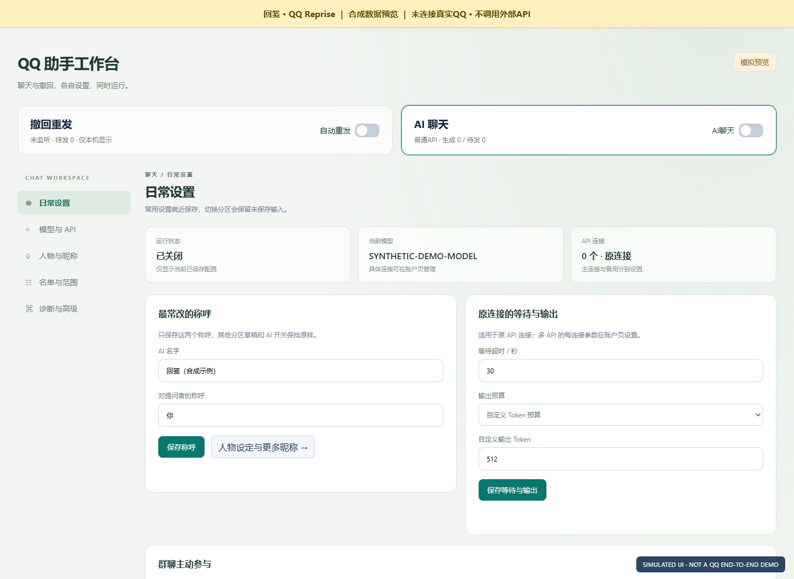
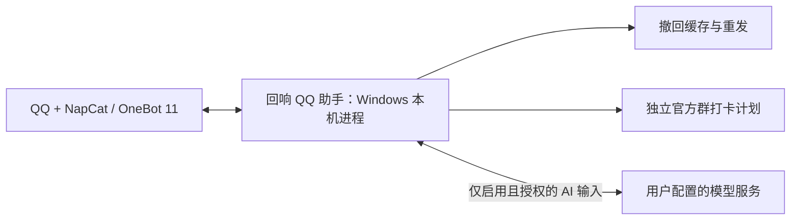

# 回响 QQ 助手

*QQ Reprise*

**Windows 自部署 QQ 助手：撤回重发 · AI 群聊 · 独立官方群打卡**

通过 NapCat / OneBot 11 连接 QQ，在自己的 Windows 电脑上分别配置撤回重发、AI 对话和官方群打卡。适合能维护 QQ/NapCat 环境、希望自己控制名单、时间和接收方的使用者。

- **撤回重发**：对已收到并成功缓存的消息，在原会话按已配置的开关与权限重建发送。合并转发、媒体和卡片有明确的支持及降级范围。
- **AI 群聊与识图**：配置自己的 API 或可选 OAuth 接入，在授权范围内使用 @、昵称触发和连续对话；普通 API 的 Responses / Chat Completions 可验证接入单图、多图与同会话图片引用，默认关闭图片外发。群背景外发另需启用。
- **官方群打卡**：按群设置每日时间、时区或手动执行；持久化去重，可独立设置检查精度、并发与启动间隔，明确区分请求已发送、记录已确认和结果未知。默认关闭、无群启用。
- **本机管理**：分别查看本地暂停状态与历史上游结果、连接、队列和脱敏诊断；撤回重发、AI、私聊回复、主动参与等功能分别控制。

只能恢复助手实际接收并成功缓存的内容，无法找回启动前或已被淘汰的消息。上下文和撤回缓存主要保存在 RAM 中，重启不提供完整历史恢复。本项目不提供完整 QQ 备份或任意历史回看。

公开示例默认关闭 AI、自动重发和官方群打卡，需自行安装 QQ / NapCat、配置接收方并明确开启功能。当前已有离线合成测试；真实客户端、供应商、OAuth 和全部媒体组合的验证边界见[测试记录](TESTING.md)。

## 可以怎样用

| 场景 | 现有功能怎样处理 | 使用条件 |
| --- | --- | --- |
| 群里撤回一段“演示文字” | 在原会话按配置重建已成功缓存的内容；转发和媒体按支持矩阵处理 | 助手当时已收到并缓存，且该会话的重发已明确开启 |
| 在允许群中真实@当前助手：`请解释下面这段代码的时间复杂度` | 把授权输入交给自己配置的模型，分别记录模型完成和QQ投递 | 已绑定本人QQ、允许该群/成员，且API或可选OAuth接入可用 |
| 群A每天00:00、群B每天08:30打卡 | 各群可覆盖全局时间/时区，按账号、群、日期去重并展示待确认/已确认/未知 | 独立总/分群开关已开启，QQ/NapCat与PacketBackend可用；不保证排名 |

上面是按已实现能力给出的使用例子，不是新发生的真实聊天或演示实拍。先看[明确标注为合成的界面预览](docs/SHOWCASE.md)，再按[快速启动](docs/QUICKSTART.md)选择一项功能；群名单、时间和策略均由使用者决定。

英文副名为 QQ Reprise，源码仓库继续使用 `qq-reprise` 标识。

[快速启动](docs/QUICKSTART.md) · [按症状排查](docs/TROUBLESHOOTING.md) · [配置指南](docs/CONFIGURATION.md) · [支持与降级范围](#支持范围) · [官方群打卡](docs/GROUP-SIGN.md) · [通用识图](docs/GENERIC-VISION.md) · [API / OAuth](#api-与-oauth) · [隐私与本地数据](#隐私与本地数据) · [测试边界](#测试与已知限制) · [MIT](LICENSE)

## 界面预览（合成数据）

下图属于旧版界面的合成示意，当前中文展示名以本文为准。图片制作于打卡面板加入前，使用当时界面代码和手写合成状态，未连接真实 QQ、未调用模型；其中状态不代表真实联调验收。撤回示例和素材边界见[展示说明](docs/SHOWCASE.md)。



## 安装与首次运行

需要 Windows、Node.js **22.4.0+**（新 AI 网络模式需 **24.14+**）、Windows PowerShell / .NET，以及独立安装并登录的 QQ/NapCat。本次离线实测 Node **24.14.0**；最低版本达标不代表所有组合已验证。代码只依赖 Node 内置模块，**无需 `npm install`**。详细版本边界、NapCat 连接和首次功能选择见[快速启动](docs/QUICKSTART.md)。

下面用于全新源码目录；自检不连接 QQ 或模型，示例明确关闭主动功能：

```powershell
git clone https://github.com/WLDKK/qq-reprise.git
Set-Location qq-reprise
node scripts/check-environment.mjs
if ($LASTEXITCODE -ne 0) { throw '请先解决离线环境自检中的问题。' }
if ((Test-Path -LiteralPath 'config.json') -or (Test-Path -LiteralPath 'ai-settings.json')) {
    throw '已有配置，请保留原文件，不要覆盖。'
}
Copy-Item -LiteralPath 'examples\config.example.json' -Destination 'config.json'
Copy-Item -LiteralPath 'examples\ai-settings.example.json' -Destination 'ai-settings.json'
node qq-recall.mjs --no-browser
```

打开终端输出的本机地址，核对 QQ 在线和账号绑定，再选择要开启的功能。已有配置升级时保留原文件；不要复制示例覆盖，也不要同时启动生产、开源副本和备份目录。AI 接口测试与手动打卡分别是真实动作，离线自检不会调用它们。



不确定卡在哪一步时，从[按症状排查](docs/TROUBLESHOOTING.md)进入；不要把管理页可打开或本地未暂停当作供应商恢复。完整配置自由度和继承关系见[配置指南](docs/CONFIGURATION.md)。

想先验证一项功能，可按[单个获准会话的最小试用](docs/QUICKSTART.md#在一个获准会话中完成最小试用)操作。反馈时使用[Issue入口](https://github.com/WLDKK/qq-reprise/issues/new)和[脱敏复现格式](docs/TROUBLESHOOTING.md#提交一个可处理的问题)，无需上传整个运行目录。

## 公开默认配置

请保留并使用两个 [匿名示例](examples/config.example.json) 和 [AI 示例](examples/ai-settings.example.json)。发布示例中：

| 项目 | 首次状态 |
| --- | --- |
| QQ / 群 / 好友 / 用户 / 昵称绑定 | 空，不含生产账号 |
| AI 后端 | 标准 API；AI 总开关关闭；无已保存凭据 |
| 自动启动、自动撤回重发、自身撤回重发、自动登录恢复 | 关闭 |
| 私聊回复、主动参与、识图及图片引用 | 关闭 |
| QQ 群官方打卡 | 总开关关闭、无群；默认 Asia/Shanghai，错过计划跳过 |
| 群背景外发 | 关闭；启用时需明确绑定当前 API 接收方 |
| 撤回缓存示例 | 每会话 200 条、30 分钟；仍受媒体/资源容量边界约束 |

请在全新安装中复制这些示例。代码的缺省项服务于旧配置兼容，**省略某个开关不一定等价于发布示例的显式关闭值**。全新匿名示例与空目录加载均有离线测试，但真实安装应以管理页中最终保存的范围为准。

各模块独立配置；时间、群名单和支持的预算字段均可编辑。0 不统一表示“无限”：例如 `context_turns: 0` 不保留问答历史，而 TTL 为 0 只取消按时间淘汰。具体继承关系、字段边界和独立打卡参数见 [配置指南](docs/CONFIGURATION.md)。

## 支持范围

以下是当前实现及降级约定，不能理解为所有 QQ / NapCat 版本的真实端到端验收。合并转发专项的部分证据来自历史 mock，详见 [完整支持矩阵](docs/FORWARD-SUPPORT.md)。

| 内容 / 能力 | 支持方式 | 降级或不支持的情况 |
| --- | --- | --- |
| 已接收并缓存的撤回文字、有效 QQ 表情 | 按原会话、权限和开关重发 | 启动前、未接收、被淘汰或未成功缓存的内容无法恢复 |
| 单层合并转发 | 接收时获取节点并缓存；撤回后通过专用转发接口重建 | 取节点失败或过期会显示缺失原因；仅有 forward ID 不等于已恢复 |
| 嵌套合并转发 | 按顺序展开为单张转发，保留作者与可用时间、层级提示 | 不保证原嵌套布局；循环、过深、超量会明确提示 |
| 图片、视频、语音、文件 | 对允许的 QQ 媒体 URL / 内嵌数据及时缓存可用字节，再使用对应消息段 | 资源失效、超时、超预算或只有资源 ID 时显示缺失说明 |
| JSON / XML 卡片 | 校验并保留可用消息段；页面只显示安全摘要 | 无效、过大或危险实体声明降级；客户端是否接受仍需实测 |
| 转发档案内的历史 @ | 转为可见的 `@成员` / `@全体成员` 文字 | 不重新通知历史提及的人 |
| 任意本机文件路径、私网/非允许站点资源、无正文引用节点 | 不抓取 | 不扫描其他会话、任意历史或本机私人文件来补齐 |
| miniapp、onlinefile、flashtransfer 等专用消息段 | 暂不承诺重建 | 用未支持说明代替，不伪称恢复成功 |
| QQ 群官方打卡 | 按群定时/手动，账号+群+日期持久化去重 | 需 NapCat PacketBackend；仅提交不算确认，未知不自动重打，UTC 查询日期限制见[说明](docs/GROUP-SIGN.md) |
| AI 文字、群内有序 @ 与称呼 | 在已配置的群/用户范围内处理 | 无工具、终端执行或账号管理能力 |
| AI 图文输入 | Responses / Chat Completions；验证绑定端点、协议、模型与图片数量；支持当前一条消息的多图与另行启用的同会话图片定位 | 默认关闭；数量、大小与超时可调；模型/账户实际能力需验证，多个独立历史候选不自动拼图，见[识图说明](docs/GENERIC-VISION.md) |

资源还受单资源 20 MiB、总媒体 64 MiB、准备期限、层级/节点/字符等上限影响。具体数值和原样/降级规则见支持矩阵。客户端拒绝或投递结果未知时不会自动改用另一种格式重复发送。

## @、昵称与连续对话

群触发方式可选择 @、名称或口令，具体取决于管理页保存的触发规则。昵称与别名用于识别称呼；它们不会扩大已允许的群或用户范围。撤回重发昵称绑定与 AI 对话称呼分别保存。

群内输入的有序 @ 关系使用本群匿名标签传给模型，原始账号映射留在本机；输出 @ 由本地允许范围校验后生成。不能让模型提供任意账号来通知其他人。转发聊天档案内的 @ 只作为历史文字重建。

同一会话中的连续输入按顺序处理，不同会话受全局并发与队列限制。上下文按账号、会话和用户范围隔离，并按任务链、话题及引用关系选择；不能保证理解每一次换题或代词指向。群背景导出需要另行启用，不跨群共享，不自动读取旧 QQ 历史。

对话上下文、图片定位、撤回内容缓存和待确认投递主要在 **RAM** 中，受轮数、字符、条数与 TTL 设置约束。TTL 为 0 表示不按时间删除，容量限制仍生效。普通重启不会恢复完整聊天内容；升级移交机制只覆盖有限状态，不能作为聊天备份。API 故障解除暂停会保留现有会话，不需要清空上下文。

未知投递保留待确认记录，允许后续新任务继续；不会自动重放旧答复。迟到回执可以更新送达状态，但不会把旧回答倒序插入后续对话。重启可能丢失 RAM 中的待确认状态，因此应先人工核对现有投递。

## AI 网络与草稿测试

AI 模型与模型列表支持独立网络配置：默认保持旧行为，也可选择明确直连、环境代理或手动 HTTP/HTTPS 代理。新模式需要 Node **24.14+**，不改 QQ/NapCat、系统代理或进程全局网络，不硬编码端口、不增加 npm 依赖。草稿测试使用合成文本，显示阶段/耗时并支持请求取消；失败会收尾，不自动重试。代理认证 URL 和 SOCKS 不在当前支持范围，取消也不保证远端停止或退费。步骤和费用边界见 [AI 网络与单次测试](docs/AI-NETWORK-AND-TEST.md)、[本次修复说明](docs/UPDATE-20261029-AI-NETWORK.md)。

## API 与 OAuth

| | 标准 API（默认路径） | OAuth（可选路径） |
| --- | --- | --- |
| 配置 | 接收平台、HTTPS 基础地址、模型、协议格式和自己的 API 密钥 | 用户主动发起浏览器授权，选择返回的账号配置与模型 |
| 权限与费用 | 由所选 API 供应商决定，费用/额度与本地计数不是同一件事 | 由官方账号资格、授权范围和可用额度决定，不自动获得 API 额度 |
| 凭据边界 | 密钥在本机界面保存，并绑定已确认的目标，不能静默用于另一个站点 | 使用官方公开 OSS 动态注册入口；回调后校验并保存独立签发的客户端 ID |
| 本版验证 | 合成请求、协议/错误/目标绑定与恢复契约通过；没有真实供应商联调 | 合成授权边界测试通过；没有真实登录或注册联调 |

标准 API 支持 `chat_completions` / `responses` 路径，实际模型能力与流式协议由供应商决定。先保存当前平台、地址、模型和凭据，再决定是否做一次接口测试和启用；测试草稿与保存配置是分开的动作。

OAuth 不读取 Codex 或浏览器的已有账号存储，也不借用其他应用已签发的客户端 ID。`dynamic_agent_client` 是 [官方 OSS 注册入口](https://developers.openai.com/siwc/token-sharing-open-source/sign-in)，后续交换/刷新使用用户授权后签发的 ID。随意填写一个标识不能替代授权、账号资格或额度；此路径不等于网站 OAuth 配置。详见 [OAuth 契约核验](docs/OAUTH-AUDIT.md)。

### 429、暂停与恢复

HTTP 429 只说明上游拒绝了这次请求，不能单凭状态码判断 RPM、TPM、账户余额或服务容量。助手记录脱敏错误类别和可用的 `Retry-After` 信息。

已明确分类为临时限流、且本地恢复设置允许时，按退避/`Retry-After` 有限等待；不把旧题自动重发。明确额度、授权、不支持或无法分类的错误需要人工处理。管理页的人工恢复要求当前同一配置的成功接口测试，并检查生成和未知投递状态；测试成功才可以解除相应暂停，既有上下文与独立开关会保留。

不要把“管理页可打开”“健康接口返回成功”或“代码已发布”理解为模型恢复。核对最近接收、触发、入队、上游请求/响应和发送状态，才能区分连接、权限、排队、供应商及投递问题。

临时冷却结束只解除本地暂停，不会自动验证供应商。页面的“上游历史观察”保留已有诊断中的最后失败和完整响应，并明确标注未核对当前接口/模型；更换配置后，旧错误或旧成功都不能代表新配置状态。该摘要不新增请求、聊天正文或长期记忆；细节见 [本轮维护说明](docs/UPDATE-20261026-OBSERVABILITY.md)。

## 隐私与本地数据

本地管理服务不等于所有内容都只留在本机。启用外部 AI 后，允许的输入、选定历史/背景、用户指令及启用时的图片会交给配置的供应商。群成员匿名标签不能匿名化消息正文中自行写出的身份信息；具体敏感值过滤也不是完整隐私分类器。

首次使用前确认自己对会话的处理范围和接收方。公开默认关闭私聊回复、主动参与与群背景导出；不要把开启某项功能理解为允许扫描所有历史或跨群共享。

运行时文件保存在本地项目目录中，**都不应进入公开仓库**：

| 文件 / 数据 | 内容与管理边界 |
| --- | --- |
| `config.json`、`ai-settings.json`、本地连接/账户配置 | 私有运行设置；升级保留，分享前脱敏 |
| `ai-secrets.dpapi.json`、`ai-pool-secrets.dpapi.json` | Windows 当前用户 DPAPI 加密凭据；不要上传，拷到另一用户环境也不保证可解密 |
| `ai-accounts.json`、`ai-host.json`、`recall-name-bindings.json` | 账号/注册元信息、主机标识和昵称绑定；不是匿名示例 |
| `ai-usage.json`、账户池及主动参与账本 | 计数/预算状态；不包含完整对话备份，删除可能影响本地限额与审计 |
| `ai-diagnostics.json`、`ai-oauth-diagnostic.json` | 脱敏状态、时间、错误类别及有限诊断记录；不应用作公开附件 |
| `ai-private-review-archive.json` | 本地审核归档元信息，例如尾号、原因和计数；不是完整私聊长期保存功能 |
| `group-sign-settings.json`、`group-sign-ledger.json` | 私有群计划、账号/群/日期去重与结果记录；升级保留，不要清空后猜测重打 |
| RAM 缓存、临时移交/实例文件、自行重定向的控制台日志 | 可能含运行状态或消息相关信息；不得整包提交 |

查看或清理数据前先暂停/退出助手、确认队列与未知投递，并保存需要的私有备份。重启会清除 RAM 内容；它不会自动清除已持久化的配置、绑定、用量和审核元信息。只清理明确知道用途的文件，不要用清账本来假装上游额度恢复。提交问题时仅提供必要的脱敏时间线和错误类别，避免上传 Token、回调 URL、完整日志或整个运行目录。

`.gitignore` 是辅助保护，不能替代审查。完整发布排除项见 [数据边界](PUBLISH-EXCLUSIONS.md)。

## 测试与已知限制

在 Windows PowerShell 中运行：

```powershell
node run-offline-tests.mjs
```

该入口只使用合成消息和 mock，阻断 Internet、生产目录和非测试端口；允许测试自己创建的临时本地 HTTP 服务和固定 DPAPI 合成数据往返。报告保存在系统临时目录，不写入源码目录。测试需要正常 Windows 的相应系统能力，受限沙箱可能无法执行本地监听或 DPAPI。不要把测试隔离工具预加载到正在运行的助手。

本版完整离线回归 **33 个测试文件、664/664 项通过，0 失败/跳过/取消/隔离守卫阻断**。原 628 项保留，新增 36 项通用识图回归；保留私有称呼默认值的生产代码组合另行同样通过 664 项。独立合成浏览器识图流程 **22/22** 通过，覆盖两协议、多图验证、范围开启、限制保存/重载、目标切换、错误和取消；不代表真实供应商模型、代理出口或 QQ 图片链路已联调。旧夹具调整和原基线 50 项失败分类见 [测试记录](TESTING.md)、[逐项分类](docs/TRIAGE-50.md)。

此前仅对兼容 NapCat 的本机连接、PacketBackend 元数据和非到点计时作过只读验收；本轮配置说明与历史结果展示仅做离线合成验证，未验证真实群打卡、完整 QQ 消息与模型供应商联调、真实 OAuth 登录、所有媒体/卡片组合、长期运行与跨系统/多 Node 版本兼容。合并转发的完整历史专项未在当前 664 项内全部重跑，当前支持声明需结合 [矩阵中的证据边界](docs/FORWARD-SUPPORT.md) 阅读。发布代码不代表这些集成已经通过，也不代表任何现有实例的上游服务恢复。

## 许可证与来源

本项目按 [MIT License](LICENSE) 发布，Copyright (c) 2026 WLDKK。

未打包 QQ / NapCat；它们由使用者独立安装并遵循各自条款。NapCat 的许可不由本项目重新授权。[第三方说明](THIRD-PARTY-NOTES.md) 和 [来源审计](docs/PROVENANCE-AUDIT.md) 记录了设计/协议参考、具体路径和整文件核验边界；检查范围内未发现第三方复制源码证据。

发布仅包含经核验的源码、合成测试、匿名配置与文档，使用全新公开历史，不包含生产数据与旧私有 Git 对象。文件摘要见 [发布文件清单](RELEASE-MANIFEST.json)。
