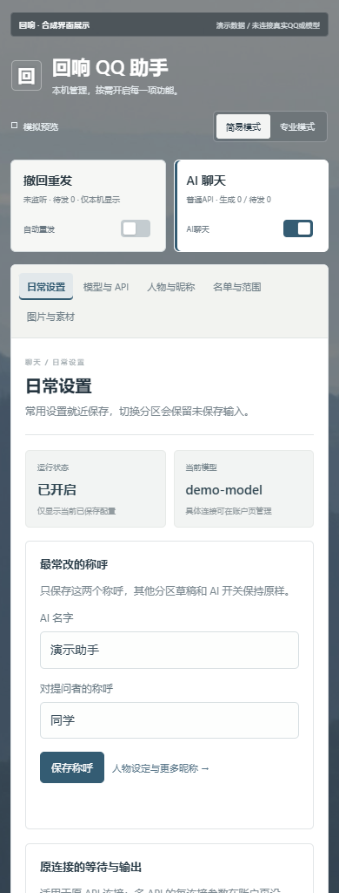
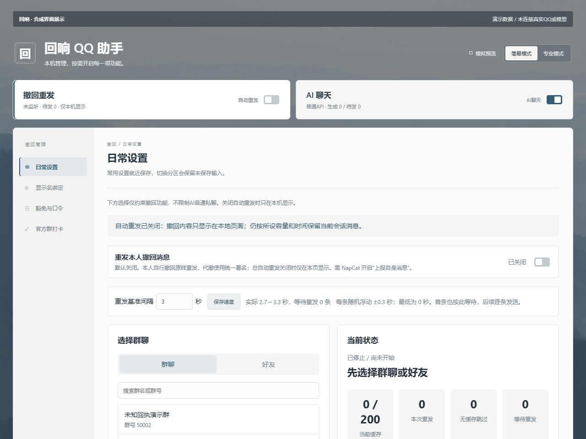

# 当前工作台展示：合成数据

这些截图来自当前公开候选的真实HTML/CSS，由隔离模拟服务和浏览器渲染。顶部保留“合成界面展示 / 演示数据”标识；演示账号、群、称呼和模型均为固定合成内容，未连接真实QQ或模型服务。

## 桌面日常设置

1280×960。展示山雾壁纸、本机状态、简易/专业切换、导航和独立保存的表单。截图不代表供应商或QQ真实链路已经通过。

## 手机日常设置

390×1024。保留功能开关和分区导航，内容单列排列；专业设置仍可展开。

## 撤回管理

展示独立监视范围、自身撤回开关和本机状态。此图没有演示实际撤回或真实QQ重发回执；媒体和合并转发边界见[支持矩阵](FORWARD-SUPPORT.md)。

壁纸作为固定本机资源随应用提供，摄影归camera obscura，保留[Unsplash许可及来源](WALLPAPER-CREDIT.md)。截图不包含生产消息、个人昵称绑定、真实账号、凭据或二维码。

制造与验收使用离线守卫：模型与QQ由注入响应代替，浏览器仅访问本次本机端口。完整设置、主题与固定资源检查见[测试记录](../TESTING.md)。
